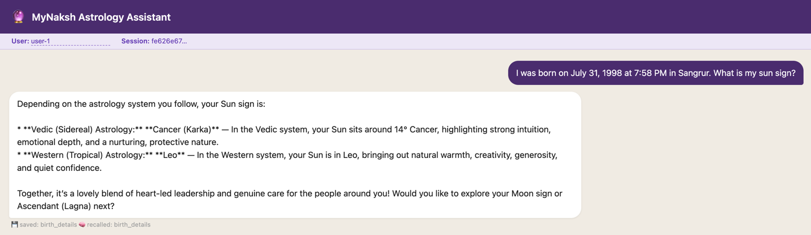

# MyNaksh — Personalized Astrology Chat

A FastAPI chat service with a browser UI that answers with an LLM, remembers useful facts
about a user across sessions, and sends the LLM only the memories relevant to the current question.

## UI



## Quick start

```bash
cd mynaksh-chat
python -m venv .venv && source .venv/bin/activate
pip install -r requirements.txt
```

Set your LLM credentials (see **Configuration** below), then:

```bash
uvicorn app.main:create_default_app --factory --reload
```

Open **http://localhost:8000** for the chat UI, or **http://localhost:8000/docs** for the
interactive API docs.

## Configuration

All settings live in `app/config.py` and can be overridden with environment variables.

| Env var | Default | Purpose                                                                                                                          |
|---|---|----------------------------------------------------------------------------------------------------------------------------------|
| `LLM_PROVIDER` | `mock` | `mock` · `anthropic` · `gemini` · `openai` · `grok` · `qwen` · `kimi` · `deepseek` · `groq` · `openrouter` · `ollama` · `custom` |
| `LLM_MODEL` | – | Model name, e.g. `gemini-4-hydrogen`, `gpt-4-astra`, `claude-haiku-5-5`                                                          |
| `LLM_API_KEY` | – | API key; falls back to the provider's own variable (e.g. `GEMINI_API_KEY`)                                                       |
| `LLM_BASE_URL` | – | Override the endpoint URL (required for `LLM_PROVIDER=custom`)                                                                   |
| `DB_PATH` | `chat.db` | SQLite file for chat history and memories                                                                                        |
| `LOG_FILE` | `app.log` | Log file path                                                                                                                    |

**Gemini example**

```bash
export LLM_PROVIDER=gemini
export LLM_MODEL=gemini-4-hydrogen
export GEMINI_API_KEY=your-key-here
uvicorn app.main:create_default_app --factory --reload
```

**Anthropic example**

```bash
export LLM_PROVIDER=anthropic
export LLM_MODEL=claude-haiku-5-5
export ANTHROPIC_API_KEY=sk-ant-...
uvicorn app.main:create_default_app --factory --reload
```

Without any env vars, the service starts with a mock LLM that echoes your message — useful
for testing the memory and history logic without an API key.

## Logging

Logs are written to both **stdout** (visible in the uvicorn terminal) and **`app.log`** in the
working directory. The log level is `DEBUG`, so every request, LLM selection, memory save,
and memory recall is recorded.

```
2026-11-15 10:00:01 INFO  app.llm: LLM provider=gemini model=gemini-2.0-flash base_url=https://...
2026-11-15 10:00:01 INFO  app.main: App started — db=chat.db
2026-11-15 10:00:05 INFO  app.main: chat request  user=user-1 session=abc message='What is my moon sign?'
2026-11-15 10:00:06 DEBUG app.chat_service: LLM reply user=user-1 session=abc reply='Your moon sign...'
2026-11-15 10:00:06 INFO  app.main: chat response user=user-1 session=abc memories_saved=[] context_used=[]
```

## Running tests

No API key or network connection needed:

```bash
cd mynaksh-chat
pytest
```

## Architecture

```
mynaksh-chat/
  app/
    config.py        All constants and environment variables (single source of truth)
    main.py          FastAPI app: POST /chat, GET /users/{id}/memories, GET /
    chat_service.py  One chat turn: remember → recall → prompt → LLM → store
    memory.py        Rule-based logic for saving and retrieving memories (pure, no I/O)
    llm.py           LLMClient protocol + Anthropic, OpenAI-compatible, and Mock clients
    storage.py       SQLite: messages table (session history) + memories table
    static/
      index.html     Browser chat UI
  tests/
    test_chat.py     End-to-end tests through the HTTP API with an in-memory DB and mock LLM
```

Dependencies flow one way: `main → chat_service → memory / llm / storage`.
`create_app(storage, llm)` lets tests inject an in-memory database and a mock LLM without
touching any global state.

### One chat turn

1. **Remember.** Extract facts from the message and upsert them into `memories`.
2. **Recall.** Pick only the memories relevant to this message.
3. **History.** Load the last 6 messages (3 exchanges) of *this session only*.
4. **Generate.** System prompt = persona + relevant memories + language instruction;
   user messages = history + current message. If the LLM fails, return a graceful fallback.
5. **Store.** Save the user message and reply to `messages` for future history.

## Memory system

**Storage.** One row per `(user_id, category)`, e.g. `career_goal` or `language_preference`.
Saving the same category again replaces the old value, so corrections work automatically.
`interests` accumulates (people have more than one).

**What gets saved (rule-based).** The message is split into statements. Questions are skipped.

- *Goals* (career, relationship, finance, education, health) need a topic word (*job*, *marriage*…)
  **and** an intent word (*planning*, *want*, *hope*…).
- *Facts* need a trigger phrase: *"I was born…"*, *"I live in…"*, *"I love…"*.
- *Language preference* is matched with patterns like *"prefer … Hindi"* or *"reply in English"*.
- All of the above must be first-person (*I / my / me*), so *"my sister is getting married"*
  is not saved as the user's goal.

**What gets retrieved.** A memory is included only if the question mentions that category's
topic words, or shares a meaningful (non-stopword) word with the stored value. Language
preference is always included. A question like *"What do you remember about me?"* returns
everything. The `context_used` field in every response lists exactly which memories were sent.

### Why rule-based instead of embeddings or an LLM extractor?

- **Predictable and testable** — tests assert exact behaviour with no flakiness or API cost.
- **Cheap and fast** — no extra LLM call per message.
- **Easy to explain** — every save/recall decision traces to a named rule.

`memory.extract_memories` is a pure function with the same output shape an LLM extractor
would produce, so it can be swapped without touching any other module.

## API reference

### `POST /chat`

```bash
curl -X POST http://localhost:8000/chat \
  -H "Content-Type: application/json" \
  -d '{"user_id": "user-1", "session_id": "session-1", "message": "What is my moon sign?"}'
```

```json
{
  "user_id": "user-1",
  "session_id": "session-1",
  "response": "Based on your birth details (July 31, 1998, at 7:58 PM in Sangrur), your **Vedic Moon sign (Chandra Rashi) is Libra (Tula)**, with the Moon placed around **15° Libra** (in Swati Nakshatra).\n\n*(Note: If you also follow Western/Tropical astrology, your Moon sign there is **Scorpio**.)*\n\n**What a Libra Moon means for you:**\n* **Emotional style:** You naturally seek balance, peace, and harmony in your surroundings and relationships. Conflict can feel unsettling, so you often play the mediator.\n* **Practical strength:** You have a strong sense of fairness, good diplomatic instincts, and an appreciation for beauty, art, and thoughtful conversation.\n* **Gentle tip:** Because you care deeply about keeping things harmonious, be mindful not to over-compromise or stay indecisive just to keep everyone else happy—giving your own needs equal weight brings you the greatest emotional ease.",
  "context_used": ["birth_details"],
  "memories_saved": []
}
```

> `context_used: ["birth_details"]` shows the service recalled the user's saved birth details
> and passed them to the LLM to compute the moon sign — no manual lookup needed.

### `GET /users/{user_id}/memories`

```json
[
  { "key": "career_goal",        "value": "I am planning to switch jobs next year" },
  { "key": "interests",          "value": "I love painting" },
  { "key": "language_preference","value": "Hindi" }
]
```

### `GET /`

Returns the browser chat UI.

## Tests

| Test | Verifies |
|---|---|
| `test_user_gets_a_response` | Basic request/response shape |
| `test_memory_is_saved_and_recalled_in_a_new_session` | Cross-session memory reaches the LLM prompt |
| `test_follow_up_question_uses_session_history` | History is sent for follow-ups; sessions are isolated |
| `test_irrelevant_memories_are_excluded` | An interest is not sent for a career question |
| `test_questions_are_not_stored_as_memories` | Not every message becomes a memory |
| `test_correction_replaces_old_memory` | "Reply in English" replaces "Hindi" |
| `test_memories_are_isolated_per_user` | No memory leakage between users |
| `test_fallback_reply_when_llm_fails` | Provider outage returns a graceful fallback |

## Known limitations

- Follow-up questions (*"Why do you say that?"*) don't re-retrieve memories because they
  carry no topic words. Context is preserved via session history, but explicit memory recall
  could also carry over the previous turn's `context_used`.
- Single-valued categories hold only the latest statement (one career goal at a time).
- Rule-based extraction misses unusual phrasings (*"thinking of quitting"* has no career
  keyword). An LLM-based extractor with JSON output would improve recall coverage.
